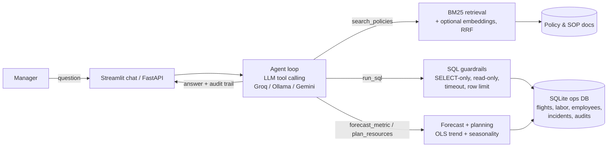

# ✈️ FlightOps Copilot

[](https://github.com/NamTran9694/flightops-copilot/actions/workflows/tests.yml)
**Live demo:** [flightops-nam.streamlit.app](https://flightops-nam.streamlit.app) · Python 3.12 · LLM tool calling · RAG · Text-to-SQL · Forecasting

**An AI agent that answers operations questions for an airline catering facility.**
A manager asks in plain English. The agent writes and runs safe SQL on the operations database, searches company
policies, and runs forecasting models. It then explains the answer and shows every step it took.

> All data is **synthetic** (generated by `scripts/generate_data.py`): about 900 flights per day, labor, employees,
> safety incidents and audits. It is modeled on real airline catering operations; no company data is used.


---

## Why I built this

I work as a Data Analyst at an airline catering facility. Managers ask me questions every day:
*"Are we on target for hours per flight?"*, *"Did the driver incentive reduce attrition?"*,
*"How many people and trucks do we need next month?"*
Each answer needs data from several systems plus knowledge of our KPI rules and SOPs.

FlightOps Copilot shows how an AI agent can answer these questions in seconds, **with numbers that come from real
queries, not from the model's memory**, and with a full audit trail.

## Results

| Evaluation | Metric | Result |
|---|---|---|
| Agent: 13 questions, ground truth computed live with SQL | numeric accuracy / tool selection | **100% / 100%** |
| Agent latency and cost (Groq, `openai/gpt-oss-120b`) | median seconds / avg tokens per question | **1.9 s / ~3,900** |
| Policy retrieval (14 labeled questions, BM25) | hit@1 / hit@3 / MRR | **0.86 / 0.93 / 0.89** |
| Flight volume forecast (60-day back-test) | MAPE | **2.2%** |
| Model comparison (3-fold time-series CV, flights) | MAPE: linear vs XGBoost | **2.4% vs 4.0%** (linear chosen) |
| Unit tests (fake LLM, no API key needed) | passing in GitHub Actions | **31** |

The golden set is small (13 questions). Next step: add harder multi-step questions to find where the agent fails.

## Demo questions

| Question | What the agent does |
|---|---|
| "What was our hours per flight last month? Are we on target?" | SQL on `daily_ops`, then reads the target from the KPI policy |
| "Did driver attrition change after the March 2025 incentive program?" | Reads the incentive policy, calculates monthly attrition before and after with SQL |
| "Forecast daily flight volume for the next 30 days." | Runs the trend + seasonality model and reports the back-test error |
| "How many FTEs and trucks do we need for December 2026?" | Resource planning tool that follows the budget planning SOP |
| "What must a driver do before raising the highloader?" | Policy search (RAG) with the section as citation |

## Architecture



**How the agent works**
1. The question goes to the LLM together with the database schema and 4 tool definitions.
2. The LLM chooses a tool. My code validates and runs it, then sends the result back.
3. If a tool returns an error (for example a wrong column name), the error goes back to the model and it fixes its own query.
4. The loop stops when the model writes the final answer (maximum 8 steps).
5. The UI shows the answer plus every SQL query, policy section, token count and time ("How I got this").

## Key features

- **Hand-written agent loop** (about 60 lines, no framework), so every step is easy to explain and debug.
- **Text-to-SQL with guardrails:** single `SELECT` only, forbidden-keyword check, read-only database connection, 5-second timeout, 200-row limit.
- **RAG over policies:** markdown chunked by section, BM25 written from scratch, optional embeddings fused with Reciprocal Rank Fusion; answers cite `document#section`.
- **Forecasting and planning:** OLS with trend and weekday/month seasonality, back-tested every run; compared with naive, seasonal naive, XGBoost and a hybrid model. Planning turns forecast flights into labor hours, FTE (+12% buffer) and catering trucks.
- **Evaluation harness:** numeric accuracy against SQL ground truth, tool-selection accuracy, retrieval hit@k and MRR, latency and token cost.
- **Free and provider-agnostic:** OpenAI-compatible API, so it runs on Groq or Gemini free tiers or a local Ollama model by changing `.env`.
- **Production basics:** Streamlit app deployed on Streamlit Community Cloud, FastAPI `/ask` endpoint, Docker image, GitHub Actions CI, per-visitor question limit, API key kept in secrets.

## Quick start

```bash
git clone https://github.com/NamTran9694/flightops-copilot.git
cd flightops-copilot
pip install -r requirements.txt
python scripts/generate_data.py          # ~620k flight rows, a few seconds
cp .env.example .env                     # then add your free GROQ_API_KEY (console.groq.com)
```

```bash
streamlit run app/dashboard.py           # dashboard + "Ask the Copilot" chat page
uvicorn app.api:app --reload             # REST API, docs at http://127.0.0.1:8000/docs
python scripts/ask.py "How many recordable incidents did we have in 2025?"
pytest -q                                # 31 tests, no API key needed
python eval/run_eval.py                  # full evaluation (use --retrieval-only without a key)
```

**Docker**
```bash
docker build -t flightops-copilot .
docker run -p 8501:8501 --env-file .env flightops-copilot                                          # app
docker run -p 8000:8000 --env-file .env flightops-copilot uvicorn app.api:app --host 0.0.0.0 --port 8000   # API
```

## Project structure

```
flightops-copilot/
├── app/
│   ├── dashboard.py              # KPI dashboard (main page)
│   ├── pages/Ask_the_Copilot.py  # chat page with audit trail
│   └── api.py                    # FastAPI /health and /ask
├── data/docs/                    # policies, SOPs, KPI definitions (RAG source)
├── eval/                         # golden_set.json + run_eval.py
├── reports/                      # model comparison chart and table
├── scripts/                      # data generator, model comparison, ask.py ...
├── src/flightops/
│   ├── agent.py                  # tool-use loop, audit trail, token tracking
│   ├── tools.py                  # tool schemas + safe execution
│   ├── prompts.py                # system prompt with rules and example SQL
│   ├── db.py                     # SQL guardrails + schema description
│   ├── rag.py                    # chunking, BM25, embeddings, RRF
│   ├── forecast.py               # forecasting + resource planning
│   └── config.py                 # provider settings (Groq / Ollama / Gemini)
├── tests/                        # 31 tests (fake LLM, no key needed)
├── Dockerfile
└── .github/workflows/tests.yml   # CI: tests + retrieval eval + Docker build
```

## Design decisions

- **The LLM never calculates numbers.** All numbers come from SQL or Python; the LLM plans and explains.
- **Errors go back to the model.** Tool errors are returned as text, so the agent corrects itself instead of crashing.
- **A simple model won the forecast comparison.** XGBoost cannot extrapolate a growing trend, so linear regression with seasonality was more accurate and easier to explain to managers.
- **SQLite for zero setup.** Only `db.py` changes to move to PostgreSQL, Snowflake or Azure SQL.
- **Fake LLM in tests.** CI runs the full agent loop and API without an API key or cost.

## Roadmap

- [ ] Harder multi-step questions in the golden set, and LLM-as-judge scoring
- [ ] Move the data to PostgreSQL with a daily pipeline (Airflow + dbt)
- [ ] Expose the tools as an MCP server
- [ ] Weekly KPI summary emailed to managers through the API (Power Automate)

## Author

**Nam Tran**: Data Analyst → AI Engineer · [LinkedIn]([https://www.linkedin.com/in/YOUR-LINKEDIN](https://www.linkedin.com/in/hoai-nam-tran-06091994cr/) · [GitHub](https://github.com/NamTran9694)
