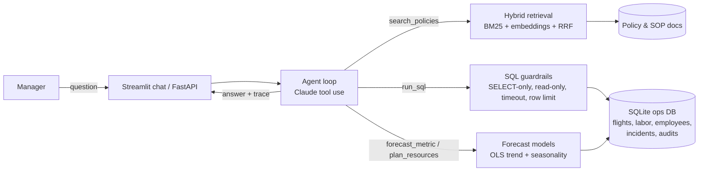

# ✈️ FlightOps Copilot

**An AI agent that answers operations questions for an airline catering facility.**
Managers ask in plain English. The agent searches company policies (RAG), writes and runs safe SQL on the
operations database (text-to-SQL), and runs forecasting models — then explains the answer and shows
every step it took.

> All data in this project is **synthetic** (generated by `scripts/generate_data.py`).
> It is modeled on real airline catering operations: ~900 flights/day, labor, safety and attrition data.

---

## Why I built this

In my job as a Data Analyst at an airline catering facility, managers and directors ask me questions every day:
*"Are we on target for hours per flight?"*, *"Did the driver incentive reduce attrition?"*,
*"How many people and trucks do we need next month?"*
Each answer needs data from several systems plus knowledge of our KPI rules and SOPs.

FlightOps Copilot shows how an AI agent can answer these questions in seconds — **with numbers that come
from real queries, not from the model's memory**, and with a full audit trail.

## Demo questions

| Question | What the agent does |
|---|---|
| "What was our hours per flight in the last 6 months? Are we on target?" | SQL on `daily_ops` + reads the KPI target from the policy docs |
| "Did driver attrition change after the March 2025 incentive program?" | Searches the incentive policy, calculates monthly attrition before/after with SQL |
| "Forecast daily flight volume for the next 30 days." | Runs a trend + seasonality model and reports back-test error |
| "How many FTEs and trucks do we need for December 2026?" | Resource planning tool that follows the budget planning SOP |
| "What must a driver do before raising the highloader?" | RAG over the driver safety policy, with citation |

## Architecture



**How the agent works**
1. The question goes to the LLM together with the database schema and 4 tool definitions.
2. The LLM decides which tool to call. My code runs the tool and sends the result back.
3. If a tool returns an error (for example bad SQL), the error goes back to the model and it fixes its own query.
4. The loop stops when the model writes the final answer (max 8 steps).
5. The UI shows the answer and every tool call, SQL query, token count and time.

## Key features

- **Agentic tool use** — a hand-written agent loop (no heavy framework), so every step is easy to explain and debug.
- **Text-to-SQL with guardrails** — single `SELECT` only, forbidden-keyword check, database opened in read-only mode, 5-second query timeout, 200-row limit.
- **Hybrid RAG** — markdown documents are chunked by section; BM25 keyword search (built from scratch) is fused with optional vector search using Reciprocal Rank Fusion. Answers cite `document#section`.
- **Forecasting & planning tools** — OLS regression with trend, day-of-week and month seasonality; back-tested (MAPE) every time it runs. Resource planning follows the facility's budget rules (FTE buffer, truck capacity, H/F floor).
- **Evaluation harness** — retrieval metrics (hit@k, MRR) and agent metrics (numeric accuracy vs. ground truth SQL, tool-selection accuracy, latency, token cost).
- **Production basics** — prompt caching, REST API, Docker, GitHub Actions CI, 19 unit tests (including the agent loop with a fake LLM, so tests need no API key).

## Results

| Evaluation | Metric | Result |
|---|---|---|
| Retrieval (14 labeled questions, BM25 only) | hit@1 / hit@3 / MRR | **0.86 / 0.93 / 0.89** |
| Flight volume forecast (60-day back-test) | MAPE | **~2.2%** |
| Hours-per-flight forecast (60-day back-test) | MAPE | **~3.2%** |
| Agent (13 questions with SQL ground truth) | numeric accuracy / tool selection | *run `python eval/run_eval.py` and add your numbers here* |

## Quick start

**1. Install** (Python 3.10+)
```bash
git clone https://github.com/<your-username>/flightops-copilot.git
cd flightops-copilot
python -m venv .venv
# Windows: .venv\Scripts\activate     Mac/Linux: source .venv/bin/activate
pip install -r requirements.txt
```

**2. Create the synthetic data** (~5 seconds, ~620k flight rows)
```bash
python scripts/generate_data.py
```

**3. Add your API key** — copy `.env.example` to `.env` and set `ANTHROPIC_API_KEY`
(get one at https://console.anthropic.com).

**4. Run**
```bash
streamlit run app/streamlit_app.py      # chat UI + KPI dashboard
uvicorn app.api:app --reload             # REST API at http://127.0.0.1:8000/docs
python -m flightops.agent "How many recordable incidents did we have in 2025?"   # CLI (set PYTHONPATH=src)
```

**5. Test and evaluate**
```bash
pytest -q
python eval/run_eval.py --retrieval-only   # no API key needed
python eval/run_eval.py                    # full agent evaluation
```

**Docker**
```bash
docker build -t flightops-copilot .
docker run -p 8501:8501 --env-file .env flightops-copilot
```

**Optional: semantic search**
```bash
pip install sentence-transformers
# in .env: USE_EMBEDDINGS=1
```

## Project structure

```
flightops-copilot/
├── app/
│   ├── streamlit_app.py     # chat UI + KPI tab
│   └── api.py               # FastAPI /ask endpoint
├── data/docs/               # policies, SOPs, KPI definitions (RAG source)
├── eval/
│   ├── golden_set.json      # labeled retrieval + agent questions
│   └── run_eval.py
├── scripts/generate_data.py # synthetic data generator
├── src/flightops/
│   ├── agent.py             # tool-use loop, trace, token tracking
│   ├── tools.py             # tool schemas + execution
│   ├── db.py                # read-only SQL + guardrails + schema description
│   ├── rag.py               # chunking, BM25, embeddings, RRF
│   ├── forecast.py          # forecasting + resource planning
│   ├── prompts.py
│   └── config.py
└── tests/test_core.py
```

## Design decisions

- **Why not let the LLM calculate numbers?** LLMs can make arithmetic mistakes. All numbers come from SQL or Python; the LLM only plans and explains.
- **Why SQLite?** Zero setup for anyone who clones the repo. The SQL guard and `run_query` function are the only parts to change for PostgreSQL, Snowflake or Azure SQL.
- **Why BM25 + embeddings?** Policy documents contain exact terms (H/F, highloader, FTE) where keyword search is strong; embeddings help with paraphrased questions. RRF combines both without tuning weights.
- **Why a simple regression for forecasting?** It is explainable to managers, fast, and back-tested. Hours per flight uses only the last 180 days because the improvement is slowing down — a long trend would be too optimistic for budgeting.

## Roadmap

- [ ] Deploy to Azure Container Apps (or Streamlit Community Cloud)
- [ ] Move data to PostgreSQL + dbt models
- [ ] Expose the tools as an MCP server so other AI clients can use them
- [ ] Add LLM-as-judge scoring for answer quality
- [ ] Add a "weekly KPI summary" job that emails managers automatically

## Author

**Your Name** — Data Analyst → AI Engineer · [LinkedIn](https://linkedin.com/in/your-profile)
